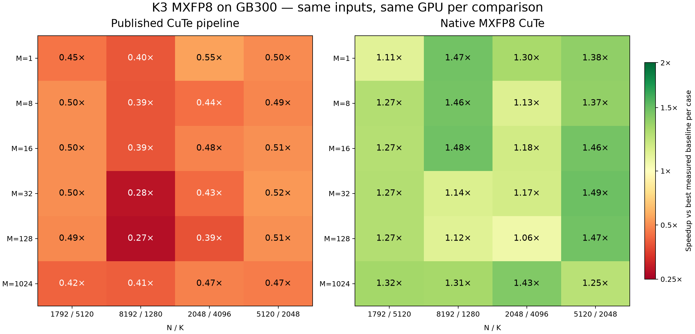

# K3 native MXFP8 hillclimb report

Updated: 2026-10-14 18:19:06 UTC

**GOAL MET in the recorded experiment.** All24 research cases meet the performance goal; the public AOT benchmark and both full regression suites completed on the recorded source snapshots.

## Scope

- Panel: 24 cases, M∈{1,8,16,32,128,1024}, with (N,K)∈{(1792,5120),(8192,1280),(2048,4096),(5120,2048)}.
- Cases04–07 use M=8 at the user’s request. The earlier M=7 case04 result is archived and excluded.
- Native support lowers a proved full-K E4M3/E8M0 `hl.dot_scaled` contraction on Blackwell. The public GB300 kernel-library K3 dispatch now uses mxfp8_native_gemm_cute with24 saved JSON configs. Fresh public AOT paired measurements are complete; the table below retains the six-provider research comparison.
- Published CuTe baseline: the existing decode→BF16 GEMM→unsafe-patch algorithm and saved JSON AOT configs. Its isolated dispatch guard was extended to M=8; existing normal nearest-shape config selection is recorded. These baseline configs were not tuned again.

## Implementation

- Raw FP8 operands enter native block-scaled tensor-core MMA through TMA. A single kernel packs both live E8M0 scale inputs; the timed native operation uses two GPU kernels.
- The matcher proves full row/column coverage, full K, compatible layouts, a zero/absent FP32 accumulator and a rounding-only output. Extra outputs and partial domains are rejected.
- Positive-zero operand masks inserted by the compiler are recognized around raw loads and the RHS transpose. Other fill values remain unsupported, and the complete-contraction proof is retained.
- Singleton TMA coordinates retain both descriptor axes without copying/padding the operands. Under-aligned raw operands use the existing live-copy staging path.
- Format-aware geometry and seeds preserve NVFP4 defaults. Native-only source settings are canonicalized only under the complete-root proof; all96 geometry combinations and scalar/user tunables remain represented.
- MXFP8-only N64 tiles increase concurrency for smaller contractions. Two adjacent output tiles share a prepared 128-row scale chunk; the odd tile selects its upper half in TMEM. NVFP4 retains its N128/N256 vocabulary.
- The research harness and its portable tests now live in helion-kernel-library: benchmarks/mxfp8_dense_gemm_hillclimb.py and tests/test_mxfp8_dense_gemm_hillclimb.py. The Helion stack contains native lowering and autotuner support.

## Measurement protocol

- Hardware: NVIDIA GB300, sm_103, configured power limit 1400.00W. The table records each physical GPU; every native/baseline pair uses the same GPU and live inputs.
- Torch 2.14.0+cu130; CUDA 13.0; native source started from Helion279e851e. Raw artifacts record source hashes, provider configs, GPU UUID and timer details.
- Input recipe: independent normal(0,1)/3 E4M3FN values and independent E8M0 bytes125–128. FP64 decode/matmul supplies the correctness oracle.
- Every winner comes from fresh-seed, cache-bypassed full autotuning, with no search budget or generation truncation. FlashInfer tactics are freshly selected and pinned; DeepGEMM uses public dispatch; Triton/public CuTe use saved AOT configs.
- The archived searches used an experimental extension that applied custom timing to initial candidates. That extension and its settings documentation were removed from the final stack at the user's request. Initial candidates now use the built-in timer; custom callbacks retain their existing role in finalist rebenchmarking. The recorded measurements retain their original source IDs and do not represent new cold searches on the rewritten stack.
- Final timings use cold-L2 CUPTI graph replay and six alternating mirrored rounds. All providers in a case use the same timer and sampling windows. Earlier cases used100ms warmup/500ms repeat; remaining cases use20ms/100ms. Near-goal or unstable cases receive a longer pinned verification.
- Both scale transformations remain inside every provider invocation. Live-input mutations, poisoned outputs, repeated calls, graph replay and post-timing correctness are checked.
- The GPU1 shape00 trial was rejected after another process appeared. Accepted final runs have contention-monitor records and record their physical GPU per case.
- Per-shape threshold: baseline/native latency ≥0.99×. Overall threshold: geometric mean ≥1.00×. Full-panel means are withheld until all24 rows are measured.

## Latency results (µs)



| Case / M×N×K | GPU | Status | Published CuTe | Native CuTe | Triton AOT | DeepGEMM | FlashInfer CuTe | PyTorch | × published | × best | Raw result |
| --- | --- | --- | ---: | ---: | ---: | ---: | ---: | ---: | ---: | ---: | --- |
| 00: 1×1792×5120 | 2 | PASS | 34.080 | 13.888 | 15.456 | 16.992 | 18.144 | 88.480 | 2.454× | 1.113× | [cold_shape00_final_v1.json](/home/shangdiy/helion-native-mxfp8-20261013T185629Z/artifacts/k3-native-mxfp8-20261013t185629z/cold_shape00_final_v1.json) |
| 01: 1×8192×1280 | 2 | PASS | 37.056 | 9.985 | 18.112 | 14.705 | 19.296 | 96.481 | 3.711× | 1.473× | [cold_shape01_final_v1.json](/home/shangdiy/helion-native-mxfp8-20261013T185629Z/artifacts/k3-native-mxfp8-20261013t185629z/cold_shape01_final_v1.json) |
| 02: 1×2048×4096 | 2 | PASS | 29.632 | 12.383 | 27.376 | 16.160 | 17.569 | 81.665 | 2.393× | 1.305× | [cold_shape02_final_v1.json](/home/shangdiy/helion-native-mxfp8-20261013T185629Z/artifacts/k3-native-mxfp8-20261013t185629z/cold_shape02_final_v1.json) |
| 03: 1×5120×2048 | 2 | PASS | 30.209 | 10.944 | 26.336 | 15.104 | 18.752 | 97.728 | 2.760× | 1.380× | [cold_shape03_final_v1.json](/home/shangdiy/helion-native-mxfp8-20261013T185629Z/artifacts/k3-native-mxfp8-20261013t185629z/cold_shape03_final_v1.json) |
| 04: 8×1792×5120 | 2 | PASS | 34.608 | 13.696 | 30.880 | 17.408 | 18.656 | 134.881 | 2.527× | 1.271× | [cold_shape04_final_v2.json](/home/shangdiy/helion-native-mxfp8-20261013T185629Z/artifacts/k3-native-mxfp8-20261013t185629z/cold_shape04_final_v2.json) |
| 05: 8×8192×1280 | 2 | PASS | 36.784 | 9.888 | 25.984 | 14.464 | 19.232 | 122.689 | 3.720× | 1.463× | [cold_shape05_final_v2.json](/home/shangdiy/helion-native-mxfp8-20261013T185629Z/artifacts/k3-native-mxfp8-20261013t185629z/cold_shape05_final_v2.json) |
| 06: 8×2048×4096 | 1 | PASS | 29.295 | 11.424 | 12.928 | 16.064 | 17.504 | 117.024 | 2.564× | 1.132× | [cold_shape06_n64_final_v1_gpu1.json](/home/shangdiy/helion-native-mxfp8-20261013T185629Z/artifacts/k3-native-mxfp8-20261013t185629z/cold_shape06_n64_final_v1_gpu1.json) |
| 07: 8×5120×2048 | 2 | PASS | 30.144 | 10.752 | 19.072 | 14.720 | 18.624 | 140.369 | 2.804× | 1.369× | [cold_shape07_final_v2_gpu2.json](/home/shangdiy/helion-native-mxfp8-20261013T185629Z/artifacts/k3-native-mxfp8-20261013t185629z/cold_shape07_final_v2_gpu2.json) |
| 08: 16×1792×5120 | 0 | PASS | 34.288 | 13.632 | 35.984 | 17.248 | 18.752 | 133.250 | 2.515× | 1.265× | [cold_shape08_final_v2_gpu0.json](/home/shangdiy/helion-native-mxfp8-20261013T185629Z/artifacts/k3-native-mxfp8-20261013t185629z/cold_shape08_final_v2_gpu0.json) |
| 09: 16×8192×1280 | 0 | PASS | 36.736 | 9.760 | 18.081 | 14.432 | 16.992 | 122.465 | 3.764× | 1.479× | [cold_shape09_final_v1_gpu0.json](/home/shangdiy/helion-native-mxfp8-20261013T185629Z/artifacts/k3-native-mxfp8-20261013t185629z/cold_shape09_final_v1_gpu0.json) |
| 10: 16×2048×4096 | 0 | PASS | 28.992 | 11.921 | 14.016 | 15.984 | 17.632 | 118.592 | 2.432× | 1.176× | [cold_shape10_final_v1_gpu0.json](/home/shangdiy/helion-native-mxfp8-20261013T185629Z/artifacts/k3-native-mxfp8-20261013t185629z/cold_shape10_final_v1_gpu0.json) |
| 11: 16×5120×2048 | 0 | PASS | 30.081 | 10.448 | 27.936 | 15.296 | 17.680 | 139.121 | 2.879× | 1.464× | [cold_shape11_final_v1_gpu0.json](/home/shangdiy/helion-native-mxfp8-20261013T185629Z/artifacts/k3-native-mxfp8-20261013t185629z/cold_shape11_final_v1_gpu0.json) |
| 12: 32×1792×5120 | 1 | PASS | 34.449 | 13.664 | 32.608 | 17.344 | 20.240 | 131.329 | 2.521× | 1.269× | [cold_shape12_final_v2_gpu1.json](/home/shangdiy/helion-native-mxfp8-20261013T185629Z/artifacts/k3-native-mxfp8-20261013t185629z/cold_shape12_final_v2_gpu1.json) |
| 13: 32×8192×1280 | 1 | PASS | 35.568 | 8.896 | 10.112 | 13.712 | 16.576 | 117.121 | 3.998× | 1.137× | [cold_shape13_final_v1_gpu1_long_verify_v1.json](/home/shangdiy/helion-native-mxfp8-20261013T185629Z/artifacts/k3-native-mxfp8-20261013t185629z/cold_shape13_final_v1_gpu1_long_verify_v1.json) |
| 14: 32×2048×4096 | 1 | PASS | 29.632 | 10.944 | 12.800 | 16.384 | 19.184 | 114.593 | 2.708× | 1.170× | [cold_shape14_n64_final_v1_gpu1.json](/home/shangdiy/helion-native-mxfp8-20261013T185629Z/artifacts/k3-native-mxfp8-20261013t185629z/cold_shape14_n64_final_v1_gpu1.json) |
| 15: 32×5120×2048 | 1 | PASS | 30.273 | 10.624 | 33.504 | 15.840 | 18.976 | 139.105 | 2.849× | 1.491× | [cold_shape15_final_v1_gpu1.json](/home/shangdiy/helion-native-mxfp8-20261013T185629Z/artifacts/k3-native-mxfp8-20261013t185629z/cold_shape15_final_v1_gpu1.json) |
| 16: 128×1792×5120 | 2 | PASS | 35.617 | 13.824 | 30.720 | 17.600 | 20.352 | 149.225 | 2.576× | 1.273× | [cold_shape16_final_v1_gpu2.json](/home/shangdiy/helion-native-mxfp8-20261013T185629Z/artifacts/k3-native-mxfp8-20261013t185629z/cold_shape16_final_v1_gpu2.json) |
| 17: 128×8192×1280 | 1 | PASS | 37.712 | 9.216 | 10.304 | 15.616 | 18.240 | 145.473 | 4.092× | 1.118× | [cold_shape17_n64_final_v1_gpu1.json](/home/shangdiy/helion-native-mxfp8-20261013T185629Z/artifacts/k3-native-mxfp8-20261013t185629z/cold_shape17_n64_final_v1_gpu1.json) |
| 18: 128×2048×4096 | 1 | PASS | 30.432 | 11.168 | 11.808 | 16.832 | 19.232 | 129.136 | 2.725× | 1.057× | [cold_shape18_n64_final_v1_gpu1_long_verify_v1.json](/home/shangdiy/helion-native-mxfp8-20261013T185629Z/artifacts/k3-native-mxfp8-20261013t185629z/cold_shape18_n64_final_v1_gpu1_long_verify_v1.json) |
| 19: 128×5120×2048 | 2 | PASS | 30.817 | 10.688 | 43.936 | 15.712 | 17.825 | 162.882 | 2.883× | 1.470× | [cold_shape19_final_v1_gpu2.json](/home/shangdiy/helion-native-mxfp8-20261013T185629Z/artifacts/k3-native-mxfp8-20261013t185629z/cold_shape19_final_v1_gpu2.json) |
| 20: 1024×1792×5120 | 2 | PASS | 47.424 | 14.944 | 24.993 | 19.776 | 24.224 | 428.787 | 3.173× | 1.323× | [cold_shape20_final_v1.json](/home/shangdiy/helion-native-mxfp8-20261013T185629Z/artifacts/k3-native-mxfp8-20261013t185629z/cold_shape20_final_v1.json) |
| 21: 1024×8192×1280 | 2 | PASS | 50.688 | 15.808 | 26.912 | 20.736 | 25.920 | 490.739 | 3.206× | 1.312× | [cold_shape21_final_v1.json](/home/shangdiy/helion-native-mxfp8-20261013T185629Z/artifacts/k3-native-mxfp8-20261013t185629z/cold_shape21_final_v1.json) |
| 22: 1024×2048×4096 | 2 | PASS | 40.848 | 13.568 | 20.920 | 19.392 | 24.000 | 403.972 | 3.011× | 1.429× | [cold_shape22_final_v1.json](/home/shangdiy/helion-native-mxfp8-20261013T185629Z/artifacts/k3-native-mxfp8-20261013t185629z/cold_shape22_final_v1.json) |
| 23: 1024×5120×2048 | 2 | PASS | 46.081 | 17.200 | 30.017 | 21.504 | 26.080 | 483.284 | 2.679× | 1.250× | [cold_shape23_final_v1.json](/home/shangdiy/helion-native-mxfp8-20261013T185629Z/artifacts/k3-native-mxfp8-20261013t185629z/cold_shape23_final_v1.json) |
| Summary | per case | GOAL MET | 35.060 | 12.053 | 23.366 | 16.626 | 19.570 | 178.683 | 2.916× | 1.293× | 24 cases |

The published-CuTe column is the before reference from saved AOT configs. Native is the after path found by cold full tuning. “Best” is the fastest passing measured baseline for that case. Summary latencies use arithmetic means; speedups use geometric means.

## Nominal throughput (TFLOP/s)

| Case / M×N×K | Published CuTe | Native CuTe | Triton AOT | DeepGEMM | FlashInfer CuTe | PyTorch |
| --- | ---: | ---: | ---: | ---: | ---: | ---: |
| 00: 1×1792×5120 | 0.538 | 1.321 | 1.187 | 1.080 | 1.011 | 0.207 |
| 01: 1×8192×1280 | 0.566 | 2.100 | 1.158 | 1.426 | 1.087 | 0.217 |
| 02: 1×2048×4096 | 0.566 | 1.355 | 0.613 | 1.038 | 0.955 | 0.205 |
| 03: 1×5120×2048 | 0.694 | 1.916 | 0.796 | 1.388 | 1.118 | 0.215 |
| 04: 8×1792×5120 | 4.242 | 10.719 | 4.754 | 8.433 | 7.869 | 1.088 |
| 05: 8×8192×1280 | 4.561 | 16.967 | 6.457 | 11.599 | 8.724 | 1.367 |
| 06: 8×2048×4096 | 4.582 | 11.749 | 10.382 | 8.355 | 7.668 | 1.147 |
| 07: 8×5120×2048 | 5.566 | 15.604 | 8.797 | 11.398 | 9.008 | 1.195 |
| 08: 16×1792×5120 | 8.563 | 21.538 | 8.159 | 17.022 | 15.657 | 2.203 |
| 09: 16×8192×1280 | 9.134 | 34.380 | 18.558 | 23.250 | 19.747 | 2.740 |
| 10: 16×2048×4096 | 9.259 | 22.519 | 19.152 | 16.794 | 15.224 | 2.264 |
| 11: 16×5120×2048 | 11.155 | 32.114 | 12.011 | 21.937 | 18.979 | 2.412 |
| 12: 32×1792×5120 | 17.046 | 42.974 | 18.008 | 33.856 | 29.012 | 4.471 |
| 13: 32×8192×1280 | 18.868 | 75.437 | 66.366 | 48.942 | 40.486 | 5.730 |
| 14: 32×2048×4096 | 18.118 | 49.056 | 41.943 | 32.768 | 27.985 | 4.685 |
| 15: 32×5120×2048 | 22.168 | 63.167 | 20.030 | 42.367 | 35.365 | 4.824 |
| 16: 128×1792×5120 | 65.946 | 169.908 | 76.460 | 133.455 | 115.409 | 15.740 |
| 17: 128×8192×1280 | 71.179 | 291.271 | 260.516 | 171.898 | 147.169 | 18.453 |
| 18: 128×2048×4096 | 70.567 | 192.289 | 181.867 | 127.580 | 111.662 | 16.630 |
| 19: 128×5120×2048 | 87.108 | 251.156 | 61.097 | 170.847 | 150.599 | 16.480 |
| 20: 1024×1792×5120 | 396.223 | 1257.393 | 751.830 | 950.166 | 775.681 | 43.822 |
| 21: 1024×8192×1280 | 423.667 | 1358.479 | 797.950 | 1035.631 | 828.504 | 43.760 |
| 22: 1024×2048×4096 | 420.575 | 1266.205 | 821.217 | 885.926 | 715.828 | 42.527 |
| 23: 1024×5120×2048 | 466.024 | 1248.537 | 715.434 | 998.644 | 823.422 | 44.435 |
| Arithmetic mean | 89.038 | 268.256 | 162.698 | 198.158 | 162.840 | 11.534 |

Throughput counts2MNK useful GEMM operations and includes all per-call GPU transformations in elapsed time. Absolute throughput summaries use arithmetic means.

## Additional optimization explored

A prototype packed four guarded scale-byte loads into coalesced uint32 stores. It passed46 CPU and12 CUDA tests, but the same-geometry GPU0 probe measured15.424µs →15.456µs →15.424µs (width1, width4, width1 anchors). This produced no speedup within noise, so the clean implementation retains width1. These pinned probes are not goal measurements.

The case18 width4 probe also regressed:12.320µs →12.8005µs →12.320µs. Coalesced per-thread strip batching regressed for4/8/16 items. A separate MXFP8 K512/stages2 capability passed correctness but cold full tuning selected the existing K256 config; its longer comparison remained0.956× versus Triton. Those prototypes are excluded. The N64 capability is retained because cold full tuning found it and long mirrored verification confirmed1.0573× for case18.

Probe artifacts: [scale width1](/home/shangdiy/helion-native-mxfp8-20261013T185629Z/artifacts/k3-native-mxfp8-20261013t185629z/exploratory/scale_words/probe_shape18_anchor_before.json), [scale width4](/home/shangdiy/helion-native-mxfp8-20261013T185629Z/artifacts/k3-native-mxfp8-20261013t185629z/exploratory/scale_words/probe_shape18_vector4.json), [batch4](/home/shangdiy/helion-native-mxfp8-20261013T185629Z/artifacts/k3-native-mxfp8-20261013t185629z/exploratory/scale_batches/probe_shape18_batch4.json), [batch8](/home/shangdiy/helion-native-mxfp8-20261013T185629Z/artifacts/k3-native-mxfp8-20261013t185629z/exploratory/scale_batches/probe_shape18_batch8.json), [batch16](/home/shangdiy/helion-native-mxfp8-20261013T185629Z/artifacts/k3-native-mxfp8-20261013t185629z/exploratory/scale_batches/probe_shape18_batch16.json), [K512 full search and long verification](/home/shangdiy/helion-native-mxfp8-20261013T185629Z/artifacts/k3-native-mxfp8-20261013t185629z/cold_shape18_bk512_final_v1_gpu0_long_verify_v1.json). Original paths and source hashes remain in these records.

## Recorded experiment verification

These full-suite results describe the frozen experiment snapshots before the custom initial-candidate timer was removed.

| Check | Recorded result |
| --- | --- |
| Default full suite | PASS: 16487 passed, 10378 skipped, 14680 warnings, 2768 subtests passed in 2729.11s (0:45:29) |
| CuTe full suite | PASS: 25592 passed, 1266 skipped, 203306 warnings, 4203 subtests passed in 4357.59s (1:12:37) |
| Lint | PASS: full ./lint.sh check (Ruff, format, codespell, Pyrefly0 errors) in an isolated dependency view matching lint CI. The separate benchmark environment reports8 existing optional Quack/FA4 API errors; no source suppressions were added. |
| Code review | LGTM for native lowering, proof/alias fixes, canonicalization, provider dispatch, N64 scale windows and portable harness tests |
| Focused CUDA | Native width1:12 passed; N64/new plus existing NVFP4:23 passed; final CPU-to-CUDA ordered test:2 passed; excluded width4 prototype:12 passed |

Unfinished cases07/08/12 from the first parallel attempt were excluded after a startup cache-bypass flag forced AOT baselines to tune again. The library harness now scopes bypass to the native full search and explicitly enables saved AOT lookup for public baselines. Its nine CPU tests pass.

The final N64 CPU fake compilation runs in subprocesses with no visible GPUs to keep CUTLASS’s cached architecture state local. Five CPU checks and the ordered CPU→CUDA pair pass; the 96-geometry canonicalization checks pass. These test refinements were verified separately from the frozen full-suite snapshot. An earlier shared cache key held an SM100 cubin while the successful isolated cache held SM103 under the same key. SDK cached architecture state had disagreed with the environment used for the key. CPU fake compilation does not write this cache; its cached-state leak is confirmed, and the ordered fresh-cache CPU→CUDA check passes. Accepted N64 timing runs use isolated caches.

Initial full-suite import failures were traced to the external library’s regular benchmarks package shadowing Helion’s namespace and missing expecttest/hypothesis. A test-only dependency overlay and isolated test packages resolved those failures before rerunning the suites.

## Public AOT integration

The library now contains the native kernel, its own config picker/select_config, the SM103 AOT shim,24 winning configurations, a public benchmark entrypoint and CUDA tests. Twelve focused checks pass, including typed and byte scales, wideexponent cancellation, live replay, poisoned outputs, rowpadding/broadcastscales and forbidden autotuning.

[Public AOT paired report](/home/shangdiy/helion-kernel-library/repro/breadth/final_result/gb300/paired/K03/report.md). All72 Triton/nativeCuTe/DeepGEMM receipts pass across24 cases with matching canonical inputs on GPUs0/1/2 and clean Helion4938248b. Native geometric mean latency is12.066µs versus19.370µs DeepGEMM:1.6054× speedup and24/24 wins. Native versus the faster of Triton/DeepGEMM is1.4163×. These public measurements use a three-provider scope; the research table uses six providers. Both sets of raw results and winning envelopes are now included under paired/K03, with research files in hillclimb/. The flat K03 receipts and index are refreshed and old bytes archived. The global comparison figure shows K3 CuTe1.61× with the explicit compiler override (global CuTe1.06× over184 pairs).

## Goal checker

```text
PASS 1x1792x5120: ratio 1.113 >= bar 0.990  [artifacts/k3-native-mxfp8-20261013t185629z/cold_shape00_final_v1.json]
PASS 1x8192x1280: ratio 1.473 >= bar 0.990  [artifacts/k3-native-mxfp8-20261013t185629z/cold_shape01_final_v1.json]
PASS 1x2048x4096: ratio 1.305 >= bar 0.990  [artifacts/k3-native-mxfp8-20261013t185629z/cold_shape02_final_v1.json]
PASS 1x5120x2048: ratio 1.380 >= bar 0.990  [artifacts/k3-native-mxfp8-20261013t185629z/cold_shape03_final_v1.json]
PASS 8x1792x5120: ratio 1.271 >= bar 0.990  [artifacts/k3-native-mxfp8-20261013t185629z/cold_shape04_final_v2.json]
PASS 8x8192x1280: ratio 1.463 >= bar 0.990  [artifacts/k3-native-mxfp8-20261013t185629z/cold_shape05_final_v2.json]
PASS 8x2048x4096: ratio 1.132 >= bar 0.990  [artifacts/k3-native-mxfp8-20261013t185629z/cold_shape06_n64_final_v1_gpu1.json]
PASS 8x5120x2048: ratio 1.369 >= bar 0.990  [artifacts/k3-native-mxfp8-20261013t185629z/cold_shape07_final_v2_gpu2.json]
PASS 16x1792x5120: ratio 1.265 >= bar 0.990  [artifacts/k3-native-mxfp8-20261013t185629z/cold_shape08_final_v2_gpu0.json]
PASS 16x8192x1280: ratio 1.479 >= bar 0.990  [artifacts/k3-native-mxfp8-20261013t185629z/cold_shape09_final_v1_gpu0.json]
PASS 16x2048x4096: ratio 1.176 >= bar 0.990  [artifacts/k3-native-mxfp8-20261013t185629z/cold_shape10_final_v1_gpu0.json]
PASS 16x5120x2048: ratio 1.464 >= bar 0.990  [artifacts/k3-native-mxfp8-20261013t185629z/cold_shape11_final_v1_gpu0.json]
PASS 32x1792x5120: ratio 1.269 >= bar 0.990  [artifacts/k3-native-mxfp8-20261013t185629z/cold_shape12_final_v2_gpu1.json]
PASS 32x8192x1280: ratio 1.137 >= bar 0.990  [artifacts/k3-native-mxfp8-20261013t185629z/cold_shape13_final_v1_gpu1_long_verify_v1.json]
PASS 32x2048x4096: ratio 1.170 >= bar 0.990  [artifacts/k3-native-mxfp8-20261013t185629z/cold_shape14_n64_final_v1_gpu1.json]
PASS 32x5120x2048: ratio 1.491 >= bar 0.990  [artifacts/k3-native-mxfp8-20261013t185629z/cold_shape15_final_v1_gpu1.json]
PASS 128x1792x5120: ratio 1.273 >= bar 0.990  [artifacts/k3-native-mxfp8-20261013t185629z/cold_shape16_final_v1_gpu2.json]
PASS 128x8192x1280: ratio 1.118 >= bar 0.990  [artifacts/k3-native-mxfp8-20261013t185629z/cold_shape17_n64_final_v1_gpu1.json]
PASS 128x2048x4096: ratio 1.057 >= bar 0.990  [artifacts/k3-native-mxfp8-20261013t185629z/cold_shape18_n64_final_v1_gpu1_long_verify_v1.json]
PASS 128x5120x2048: ratio 1.470 >= bar 0.990  [artifacts/k3-native-mxfp8-20261013t185629z/cold_shape19_final_v1_gpu2.json]
PASS 1024x1792x5120: ratio 1.323 >= bar 0.990  [artifacts/k3-native-mxfp8-20261013t185629z/cold_shape20_final_v1.json]
PASS 1024x8192x1280: ratio 1.312 >= bar 0.990  [artifacts/k3-native-mxfp8-20261013t185629z/cold_shape21_final_v1.json]
PASS 1024x2048x4096: ratio 1.429 >= bar 0.990  [artifacts/k3-native-mxfp8-20261013t185629z/cold_shape22_final_v1.json]
PASS 1024x5120x2048: ratio 1.250 >= bar 0.990  [artifacts/k3-native-mxfp8-20261013t185629z/cold_shape23_final_v1.json]
PASS geomean: 1.2925 (min 1.0)
GOAL MET
```

## Clean history

Worktree: `/home/shangdiy/helion-native-mxfp8-clean-20261013`; branch `yushangdi/native-mxfp8-clean-20261013`.

```text
ee7cb27c [cutedsl] Add native Blackwell MXFP8 lowering for full-K scaled dots
182f7fe3 [cutedsl] Canonicalize native MXFP8 autotuning configurations
```

The autotuning commit contains configuration canonicalization and its tests. `helion/autotuner/benchmark_provider.py`, `helion/runtime/settings.py` and `test/test_autotuner.py` match the stack base. The public AOT measurements still identify their actual compiler revision, `4938248b`; the benchmark worktree and archived receipts remain frozen.

After removing the timer extension, eight CPU canonicalization cases and four existing timing/provider regression tests pass. Ruff lint and formatting checks pass for the affected files. Logs: [canonicalization](artifacts/drop-initial-timer-20261014/cpu_checks.log) and [provider regressions](artifacts/drop-initial-timer-20261014/provider_checks.log). Native lowering and saved configuration generation are unchanged by this removal; no GPU measurements were rerun.

CI integration on 2026-10-14 exposed a compatibility issue with main's dot-operand masking change (#3934). The original CI merge `babda8c5` rejected native admission because the operands were wrapped in `_mask_to(value, 0)`. The matcher now recognizes those equivalent zero-filled operands. On that merge plus the fix, all 40 CPU and 20 CUDA MXFP8 tests pass locally; the CUDA checks used GB300 with Torch 2.14 and CUTLASS 4.7. The first PR independently passes 29 CPU admission and rejection checks. The [failed CI log](artifacts/ci3965-20261014/job-115997529526.log), [CPU checks](artifacts/ci3965-20261014/cpu-merged-fixed.log) and [CUDA checks](artifacts/ci3965-20261014/cuda_gpu1_v1/output.log) retain the evidence. The historical benchmark receipts are unchanged.

[Live progress](/home/shangdiy/helion-native-mxfp8-20261013T185629Z/artifacts/k3-native-mxfp8-20261013t185629z/PROGRESS.md) · [Measurement history](/home/shangdiy/helion-native-mxfp8-20261013T185629Z/artifacts/k3-native-mxfp8-20261013t185629z/PROGRESS_HISTORY.md) · [Goal](/home/shangdiy/helion-native-mxfp8-20261013T185629Z/artifacts/goal.json) · [Optimization plan](/home/shangdiy/helion-native-mxfp8-20261013T185629Z/artifacts/k3-native-mxfp8-20261013t185629z/PLAN.md)
