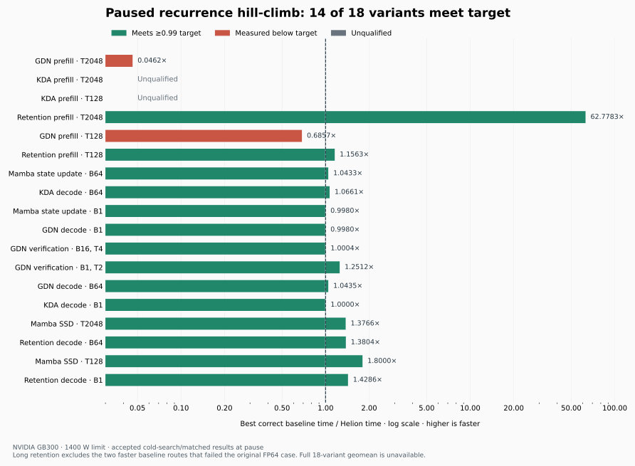

# Paused recurrence CuTe hill-climb — 13 October 2026

The user paused the hill-climb and requested history cleanup and this report. Fourteen of eighteen variants meet the performance target. Two GDN prefill variants have accepted cold measurements below target; the two KDA prefill variants remain unqualified. The all-variant geometric mean is not computable, so this report does not claim the full performance goal was achieved.

Measurements used NVIDIA GB300 GPUs (SM103a), with a recorded 1400 W power limit. GPU 0 is `GPU-3df12cd4-6163-51ae-31d8-04fbf461d685`; GPU 1 is `GPU-a58c8148-8e58-d9ae-d97f-3cd7322d9e02`. Comparisons use the original CUDA-event timer, original inputs, outputs, dtypes, tolerances, ownership checks and FP64/saturated fixtures. Mamba SSD retains its original output-only contract.

Historical before values below are unqualified observations from the initial campaign. They provide context and do not establish a qualified before-to-after speedup. Accepted after values refer to the archived cold searches and matched verification, before the final history rewrite. The rebased stack has not received a fresh full performance qualification.

All latency values are microseconds. Each row links its raw evidence under `artifacts/recurrence-cute-20261005/`. Exact per-pair times, provenance hashes and historical before paths are in the [timing audit](../../artifacts/recurrence-cute-20261005/paused-report-data-audit-20261013-v1/CASE_TIMING_AUDIT.json).

| Variant | Historical before | Accepted after | Best correct baseline / after | Target | Baseline route times | Evidence |
| --- | ---: | ---: | ---: | --- | --- | --- |
| gdn-prefill-b1-t2048-qk16-v32-d128-fp32 | 24392.440–24404.104 | 1959.040 | 0.046× | below | flashinfer-cake 90.592; flashinfer-cute 95.376; fla 132.576; sglang 153.696; vllm 169.088; fla-recurrent 2842.256; flashinfer-cake-cp 107038.322 | [raw](../../artifacts/recurrence-cute-20261005/cold-full-v1-verify-epoch1/analysis.json) |
| kda-prefill-b1-t2048-h32-d128-fp32 | 24796.800–24811.968 | — | — | unqualified | flashinfer-cake-prepared-fp32 see audit (historical); fla see audit (historical); flashinfer-cudnn see audit (historical); sglang see audit (historical); sglang-varlen see audit (historical); vllm see audit (historical); vllm-varlen see audit (historical) | [raw](../../artifacts/recurrence-cute-20261005/historical/kda-prefill-b1-t2048-h32-d128-fp32.json) |
| kda-prefill-b1-t128-h32-d128-fp32 | 3091.776–3095.376 | — | — | unqualified | flashinfer-cake-prepared-fp32 see audit (historical); fla see audit (historical); flashinfer-cudnn see audit (historical); sglang see audit (historical); sglang-varlen see audit (historical); vllm see audit (historical); vllm-varlen see audit (historical) | [raw](../../artifacts/recurrence-cute-20261005/historical/kda-prefill-b1-t128-h32-d128-fp32.json) |
| retention-prefill-b1-t2048-h8-d128-fp32 | 2613.792–2615.168 | 26.272 | 62.778× | met | fla-recurrent-prepared 1654.336 (historical); fla-recurrent-prepared-gamma 1649.312 | [raw](../../artifacts/recurrence-cute-20261005/retention-v6-qualification-only-resume-preparation-v1/qualification-resume-root-v1/RESULT.json) |
| gdn-prefill-b1-t128-qk16-v32-d128-fp32 | 3027.416–3029.920 | 53.248 | 0.686× | below | initial table, unpaired: flashinfer-cake 36.512; flashinfer-cute 59.424; fla 44.672; sglang 46.752; vllm 57.344; fla-recurrent 183.968 | [raw](../../artifacts/recurrence-cute-20261005/gdn-short-native-fill-cold-full-preparation-v8/qualification-preparation-v1/actual-qualification-v1/ROOT_MEASUREMENT_ACCEPTANCE_BELOW_TARGET_V1.json) |
| retention-prefill-b1-t128-h8-d128-fp32 | 483.968–484.496 | 12.080 | 1.156× | met | fla-prepared 18.256; fla-recurrent-prepared 124.432; fla-chunk-prepared-gamma 13.968; fla-recurrent-prepared-gamma 118.608 | [raw](../../artifacts/recurrence-cute-20261005/retention-t128-distance-public-discovery-v7/t128-full1-all-abab-gpu0-v1/results.json) |
| mamba2-decode-b64-h64-p128-n128-g8-bf16 | 105.088 | 48.448 | 1.043× | met | flashinfer-native 51.200; flashinfer-cake 50.544; vllm-ssu 61.264; sglang-ssu 73.728; mamba 116.736 | [raw](../../artifacts/recurrence-cute-20261005/mamba-b64-full-comparison-v1/all-results.json) |
| kda-decode-b64-h32-d128-bf16 | 57.480–57.776 | 30.720 | 1.066× | met | flashinfer-cake 32.752; vllm-kda-packed 38.912; sglang-kda-packed 45.056; vllm-kda-recurrent 49.152; flashinfer-cute 181.920; fla-serving-input-guard 54.944 | [raw](../../artifacts/recurrence-cute-20261005/kda-fused-discovery-v4/b64-full1-all-gpu0-v1/results.json) |
| mamba2-decode-b1-h128-p64-n128-g8-bf16 | 12.096 | 8.192 | 0.998× | met | flashinfer-native 8.192; sglang-ssu 8.192; mamba 8.176; vllm-ssu 8.192 | [raw](../../artifacts/recurrence-cute-20261005/mamba-b1-full-selected-comparison-v1/all-paired-results-v2.json) |
| gdn-decode-b1-h16-hv32-d128-fp32 | 11.392 | 8.192 | 0.998× | met | vllm-packed 8.192; flashinfer-cake 8.192; flashinfer-cute 8.192; fla 8.176; sglang-packed 10.240 | [raw](../../artifacts/recurrence-cute-20261005/gdn-fused-discovery-v5/b1-full1-abab-gpu1-v1/results.json) |
| gdn-mtp-b16-t4-h16-hv32-d128-fp32 | 49.824 | 40.960 | 1.000× | met | flashinfer-cake 40.976; flashinfer-cute 40.992 | [raw](../../artifacts/recurrence-cute-20261005/gdn-mtp-fused-discovery-v4/b16t4-full1-all-abab-gpu0-v1/results.json) |
| gdn-mtp-b1-t2-h16-hv32-d128-fp32 | 11.888 | 8.184 | 1.251× | met | flashinfer-cake 10.240; flashinfer-cute 10.240 | [raw](../../artifacts/recurrence-cute-20261005/gdn-mtp-fp32-public-discovery-v5/b1t2-full1-all-abab-gpu0-v2/results.json) |
| gdn-decode-b64-h16-hv32-d128-fp32 | 53.744 | 47.104 | 1.043× | met | flashinfer-cute 49.152; vllm-packed 53.248; sglang-packed 55.296; flashinfer-cake 56.992; fla 59.072 | [raw](../../artifacts/recurrence-cute-20261005/gdn-fused-discovery-v5/b64-full1-all-gpu0-v2/results.json) |
| kda-decode-b1-h32-d128-bf16 | 9.408–9.712 | 8.192 | 1.000× | met | flashinfer-cake 8.192; fla 8.192; vllm-kda-recurrent 8.192; vllm-kda-packed 8.192; sglang-kda-packed 10.232; flashinfer-cute 22.176; fla-serving-input-guard 8.192 | [raw](../../artifacts/recurrence-cute-20261005/kda-fused-discovery-v6/b1-full1-abab-gpu1-v1/results.json) |
| mamba2-ssd-b1-t2048-h64-p64-n128-g1 | 60.560–61.032 | 48.816 | 1.377× | met | flashinfer-cute 108.544; mamba 67.200; vllm 69.312; flashinfer-cake 120.464; sglang 366.272 | [raw](../../artifacts/recurrence-cute-20261005/mamba-ssd-discovery-v2/t2048-full1-all-gpu0-v1/results.json) |
| retention-decode-b64-h8-d128-fp32 | 19.584–20.288 | 16.192 | 1.380× | met | fla-recurrent-prepared-gamma 22.352; fla-recurrent-prepared 26.448; fla-chunk-prepared 110.416; fla-chunk-prepared-gamma 106.320 | [raw](../../artifacts/recurrence-cute-20261005/retention-decode-selected-comparison-v1/b64-full1-paired-gpu1-v1/all-paired-results.json) |
| mamba2-ssd-b1-t128-h128-p64-n128-g8 | 13.472 | 10.240 | 1.800× | met | flashinfer-cute 18.432; mamba 24.224; vllm 36.544; flashinfer-cake 61.120; sglang 85.632 | [raw](../../artifacts/recurrence-cute-20261005/mamba-ssd-discovery-v2/t128-full1-all-gpu0-v1/results.json) |
| retention-decode-b1-h8-d128-fp32 | 7.296–7.664 | 8.176 | 1.429× | met | fla-recurrent-prepared-gamma 11.680; fla-recurrent-prepared 16.224; fla-chunk-prepared 20.272; fla-chunk-prepared-gamma 18.240 | [raw](../../artifacts/recurrence-cute-20261005/retention-decode-selected-comparison-v1/b1-full1-qualified-pairs-v3.json) |
| Summary | Historical observations only | 145.879 mean across 16 measured variants | 1.562× geometric mean across the 14 target variants only | 14/18 met | Full 18-variant geometric mean unavailable | [checker](../../artifacts/recurrence-cute-20261005/checker-user-paused-20261013-v1.txt) |

The unusually large long-retention ratio uses the best correct recurrent baseline: 26.272 µs versus 1649.312 µs. Both faster chunk/prepared baseline routes failed the original collinear FP64 case and are excluded. Historical KDA baseline values are not promoted to formal comparisons.



The four unfinished variants remain explicit. Long GDN's guarded manual pipeline improved from 137.200 to 112.408 µs in matched runs; this is an internal program comparison, not qualification against the best baseline. Its general terminal-export compiler port remains private and incomplete. Short GDN V9 was stopped at the user's pause after its producer search completed; the consumer and complete two-epoch pipeline did not finish. Its partial 64.640 µs conditional producer-search objective is not a new qualified pipeline result.

For short KDA, the latest direct-K16-A program passes fourteen seven-output bitwise checks and all eleven original canonical cases. Its partial timing was 29.376/28.400 µs versus the existing program at 28.320/28.352 µs and the first Cake arm at 26.624 µs. A foreign GPU process interrupted the second Cake arm; the comparison is incomplete and the candidate is unselected. The concurrent-stream alternative was correct but slower at 35.797 µs versus Cake at 26.608 µs and was rejected. Long KDA's general MN/group-split program is correct at 952.000 µs; the earlier manual program at roughly 168.592 µs has not been reproduced through ordinary full search.

Useful code is preserved in the cleaned stack: reproducible workload and objective APIs; candidate storage/alias isolation; generic recurrent shared-image, warp/tensor-memory, positional and vector schedules; guarded Source/native compilation; and compatible full-search discovery. The reviewed uncapped seed batching and inactive flat async-stage-zero decode fix are included. Explicit invalid async stages still reject. Worker settings remain opt-in; complete compiler-seed coverage is a disclosed full-search behavior change with its own cache policy.

Five private developments remain archived as patches/proposals rather than claimed production gains: snapshot-alias single-pass reuse, optional native-worker deadline isolation, coordinate-domain point reuse, the generic GDN terminal-export port, and long-KDA intermediate-padding deferral. Their review and validation levels are recorded in the [preservation audit](../../artifacts/recurrence-cute-20261005/private-useful-changes-preservation-audit-v1/AUDIT.json). Failed and interrupted records, selected configurations, generated Sources, native images and raw timings remain intact and uncommitted.

The stack is rebased onto `origin/main` at `55f7606e` and grouped as benchmarks/objective foundation first, coupled `[cutedsl]` implementation second, and this `[noland]` report/plans last. Cleanup retains upstream functionality; it does not certify every experimental scheduler for upstream release. The relevant impact beyond CuTe includes generic argument isolation, objective/cache plumbing, AST utilities and loop-carry validation.

Validation at pause uses Python 3.12, PyTorch 2.14.0, Triton 3.8.0 and NVIDIA CUTLASS DSL 4.7.0 from the existing environment. The imported repository source is the cleaned git stack; installed Helion distribution metadata alone does not identify that source.

| Check | Result |
| --- | --- |
| Benchmark/objective first commit | 335 relevant CPU tests pass; one skip |
| Final rebased targeted checks | Initial run: 964 passed, 31 failed, 117 skipped. All 31 failures repaired; affected-file rerun: 145 passed, 69 skipped, zero failures; two no-marker cases added. Budget fixtures: 52 passed and four subtests passed. |
| Lint | Ruff format/check and codespell pass. Pyrefly has only the 41 user-waived missing JAX/Pallas imports. |
| Full default GPU suite | Unfinished; earlier full run failed and fixes received targeted checks |
| Full CuTe GPU suite | Unfinished; earlier run interrupted |
| Code review | LGTM for first-commit code and conflict resolutions; all 18 rows, plot, arithmetic and raw provenance reviewed. |

The paused checker output is preserved verbatim below.

```text
status: paused
FAIL gdn-prefill-b1-t2048-qk16-v32-d128-fp32: ratio 0.046 < bar 0.990
FAIL kda-prefill-b1-t2048-h32-d128-fp32: no measured ratio
FAIL kda-prefill-b1-t128-h32-d128-fp32: no measured ratio
PASS retention-prefill-b1-t2048-h8-d128-fp32: ratio 62.778 >= bar 0.990  [/data/users/shangdiy/helion-recurrence-hillclimb-20261005/artifacts/recurrence-cute-20261005/retention-v6-qualification-only-resume-preparation-v1/qualification-resume-root-v1/RESULT.json]
FAIL gdn-prefill-b1-t128-qk16-v32-d128-fp32: ratio 0.686 < bar 0.990
PASS retention-prefill-b1-t128-h8-d128-fp32: ratio 1.156 >= bar 0.990  [/data/users/shangdiy/helion-recurrence-hillclimb-20261005/artifacts/recurrence-cute-20261005/retention-t128-distance-public-discovery-v7/t128-full1-all-abab-gpu0-v1/results.json]
PASS mamba2-decode-b64-h64-p128-n128-g8-bf16: ratio 1.043 >= bar 0.990  [/data/users/shangdiy/helion-recurrence-hillclimb-20261005/artifacts/recurrence-cute-20261005/mamba-b64-full-comparison-v1/all-results.json]
PASS kda-decode-b64-h32-d128-bf16: ratio 1.066 >= bar 0.990  [/data/users/shangdiy/helion-recurrence-hillclimb-20261005/artifacts/recurrence-cute-20261005/kda-fused-discovery-v4/b64-full1-all-gpu0-v1/results.json]
PASS mamba2-decode-b1-h128-p64-n128-g8-bf16: ratio 0.998 >= bar 0.990  [/data/users/shangdiy/helion-recurrence-hillclimb-20261005/artifacts/recurrence-cute-20261005/mamba-b1-full-selected-comparison-v1/all-paired-results-v2.json]
PASS gdn-decode-b1-h16-hv32-d128-fp32: ratio 0.998 >= bar 0.990  [/data/users/shangdiy/helion-recurrence-hillclimb-20261005/artifacts/recurrence-cute-20261005/gdn-fused-discovery-v5/b1-full1-abab-gpu1-v1/results.json]
PASS gdn-mtp-b16-t4-h16-hv32-d128-fp32: ratio 1.000 >= bar 0.990  [/data/users/shangdiy/helion-recurrence-hillclimb-20261005/artifacts/recurrence-cute-20261005/gdn-mtp-fused-discovery-v4/b16t4-full1-all-abab-gpu0-v1/results.json]
PASS gdn-mtp-b1-t2-h16-hv32-d128-fp32: ratio 1.251 >= bar 0.990  [/data/users/shangdiy/helion-recurrence-hillclimb-20261005/artifacts/recurrence-cute-20261005/gdn-mtp-fp32-public-discovery-v5/b1t2-full1-all-abab-gpu0-v2/results.json]
PASS gdn-decode-b64-h16-hv32-d128-fp32: ratio 1.043 >= bar 0.990  [/data/users/shangdiy/helion-recurrence-hillclimb-20261005/artifacts/recurrence-cute-20261005/gdn-fused-discovery-v5/b64-full1-all-gpu0-v2/results.json]
PASS kda-decode-b1-h32-d128-bf16: ratio 1.000 >= bar 0.990  [/data/users/shangdiy/helion-recurrence-hillclimb-20261005/artifacts/recurrence-cute-20261005/kda-fused-discovery-v6/b1-full1-abab-gpu1-v1/results.json]
PASS mamba2-ssd-b1-t2048-h64-p64-n128-g1: ratio 1.377 >= bar 0.990  [/data/users/shangdiy/helion-recurrence-hillclimb-20261005/artifacts/recurrence-cute-20261005/mamba-ssd-discovery-v2/t2048-full1-all-gpu0-v1/results.json]
PASS retention-decode-b64-h8-d128-fp32: ratio 1.380 >= bar 0.990  [/data/users/shangdiy/helion-recurrence-hillclimb-20261005/artifacts/recurrence-cute-20261005/retention-decode-selected-comparison-v1/b64-full1-paired-gpu1-v1/all-paired-results.json]
PASS mamba2-ssd-b1-t128-h128-p64-n128-g8: ratio 1.800 >= bar 0.990  [/data/users/shangdiy/helion-recurrence-hillclimb-20261005/artifacts/recurrence-cute-20261005/mamba-ssd-discovery-v2/t128-full1-all-gpu0-v1/results.json]
PASS retention-decode-b1-h8-d128-fp32: ratio 1.429 >= bar 0.990  [/data/users/shangdiy/helion-recurrence-hillclimb-20261005/artifacts/recurrence-cute-20261005/retention-decode-selected-comparison-v1/b1-full1-qualified-pairs-v3.json]
geomean: not computable (unmeasured variants)
GOAL NOT MET — PAUSED at the user's instruction (the stop gate allows ending the turn)
```
