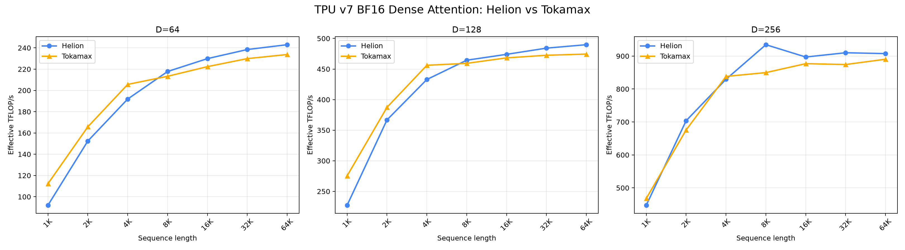
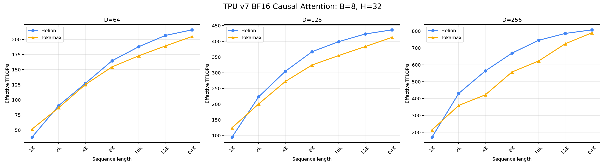

# TPU v7 attention results

Fixed-config BF16 measurements. Both dense and causal attention use B=8/H=32. Speedup is Tokamax latency divided by Helion latency.

## Dense attention

| D | Sequence | Helion ms | Tokamax ms | Helion TFLOP/s | Tokamax TFLOP/s | Speedup |
|---:|---:|---:|---:|---:|---:|---:|
| 64 | 1K | 0.7465 | 0.6119 | 92.06 | 112.31 | 0.820x |
| 64 | 2K | 1.8035 | 1.6579 | 152.42 | 165.80 | 0.919x |
| 64 | 4K | 5.7296 | 5.3461 | 191.90 | 205.66 | 0.933x |
| 64 | 8K | 20.1947 | 20.6209 | 217.78 | 213.28 | 1.021x |
| 64 | 16K | 76.5191 | 79.1127 | 229.91 | 222.37 | 1.034x |
| 64 | 32K | 295.0961 | 306.0665 | 238.46 | 229.91 | 1.037x |
| 64 | 64K | 1158.3330 | 1204.1542 | 243.00 | 233.75 | 1.040x |
| 128 | 1K | 0.6045 | 0.4991 | 227.37 | 275.36 | 0.826x |
| 128 | 2K | 1.4984 | 1.4191 | 366.89 | 387.40 | 0.947x |
| 128 | 4K | 5.0798 | 4.8209 | 432.90 | 456.15 | 0.949x |
| 128 | 8K | 18.9387 | 19.1505 | 464.45 | 459.31 | 1.011x |
| 128 | 16K | 74.2209 | 75.1369 | 474.05 | 468.27 | 1.012x |
| 128 | 32K | 290.6666 | 297.8432 | 484.19 | 472.52 | 1.025x |
| 128 | 64K | 1149.3313 | 1186.4576 | 489.81 | 474.48 | 1.032x |
| 256 | 1K | 0.6144 | 0.5873 | 447.40 | 468.06 | 0.956x |
| 256 | 2K | 1.5622 | 1.6270 | 703.81 | 675.81 | 1.041x |
| 256 | 4K | 5.3018 | 5.2470 | 829.54 | 838.20 | 0.990x |
| 256 | 8K | 18.8261 | 20.7023 | 934.46 | 849.77 | 1.100x |
| 256 | 16K | 78.4453 | 80.2452 | 897.04 | 876.92 | 1.023x |
| 256 | 32K | 309.2978 | 321.9516 | 910.05 | 874.28 | 1.041x |
| 256 | 64K | 1240.7510 | 1264.6348 | 907.43 | 890.30 | 1.019x |

## Causal attention

| D | Sequence | Helion ms | Tokamax ms | Helion TFLOP/s | Tokamax TFLOP/s | Speedup |
|---:|---:|---:|---:|---:|---:|---:|
| 64 | 1K | 0.8953 | 0.6654 | 38.41 | 51.69 | 0.743x |
| 64 | 2K | 1.5168 | 1.5801 | 90.66 | 87.02 | 1.042x |
| 64 | 4K | 4.3181 | 4.3862 | 127.35 | 125.37 | 1.016x |
| 64 | 8K | 13.3525 | 14.2293 | 164.71 | 154.56 | 1.066x |
| 64 | 16K | 46.8059 | 50.8751 | 187.94 | 172.91 | 1.087x |
| 64 | 32K | 170.2979 | 185.9417 | 206.61 | 189.23 | 1.092x |
| 64 | 64K | 651.8797 | 686.9494 | 215.90 | 204.88 | 1.054x |
| 128 | 1K | 0.7229 | 0.5509 | 95.16 | 124.85 | 0.762x |
| 128 | 2K | 1.2298 | 1.3694 | 223.63 | 200.83 | 1.114x |
| 128 | 4K | 3.6093 | 4.0395 | 304.71 | 272.25 | 1.119x |
| 128 | 8K | 11.9864 | 13.5499 | 366.96 | 324.62 | 1.130x |
| 128 | 16K | 44.0934 | 49.5975 | 399.00 | 354.72 | 1.125x |
| 128 | 32K | 166.1748 | 183.4997 | 423.48 | 383.49 | 1.104x |
| 128 | 64K | 644.7304 | 682.1573 | 436.58 | 412.63 | 1.058x |
| 256 | 1K | 0.7999 | 0.6418 | 171.99 | 214.37 | 0.802x |
| 256 | 2K | 1.2771 | 1.5301 | 430.70 | 359.48 | 1.198x |
| 256 | 4K | 3.9002 | 5.2088 | 563.96 | 422.28 | 1.336x |
| 256 | 8K | 13.1428 | 15.7808 | 669.35 | 557.46 | 1.201x |
| 256 | 16K | 47.2074 | 56.4998 | 745.36 | 622.77 | 1.197x |
| 256 | 32K | 179.0589 | 194.1353 | 786.01 | 724.97 | 1.084x |
| 256 | 64K | 697.4682 | 712.8865 | 807.15 | 789.69 | 1.022x |

